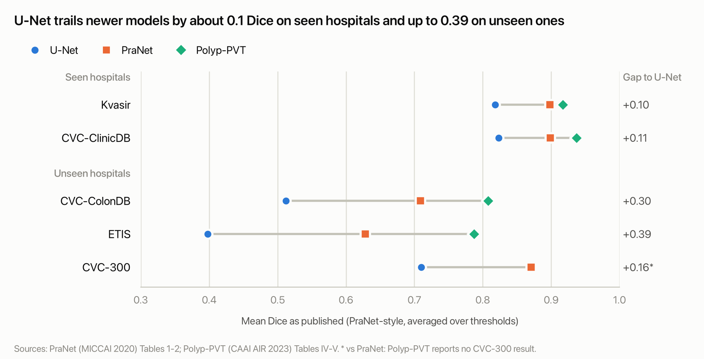

# Polyp segmentation benchmark

How much of the reported progress in polyp segmentation survives a strict protocol, and what does each step up the model ladder cost?

Three models, trained and measured the same way on the [PraNet benchmark](research/01_polyp_protocol.md): a U-Net written from scratch, a U-Net with a pretrained ResNet-34 encoder, and a linear head on a frozen DINOv3 backbone. Quality is reported next to training time, memory and latency. Everything runs on a MacBook Air M3.

**Status:** stages 1-3 of 9 done: field review; data, metrics, loader and training loop, all tested; and the PraNet reference reproduced. Our evaluation, run on the authors' released prediction maps, reproduces all 20 numbers in PraNet's Tables 1-2 within 0.005 ([report](reports/stage3_published_maps.md)), and the released PraNet weights, run on the Mac, land within 0.005 on all five test sets ([report](reports/stage3_pranet_weights.md)). Kvasir is 0.004 below the authors' maps and recorded as open. The [stage 3 page](site/stage-3.html) explains both checks. Stage 4 under way: our from-scratch U-Net gives exactly the same outputs as milesial/Pytorch-UNet with the same weights, and its five training runs (about 4-7 hours each on the MacBook Air) are in progress: the first finished with a validation Dice of 0.854. No results from our own models yet.

<picture>
  <source srcset="research/figures/published_dice_dark.png" media="(prefers-color-scheme: dark)">
  
</picture>

*The starting point: published numbers, before any re-measurement. Sources in [published_results.csv](research/published_results.csv).*

## Setup

Requires macOS on Apple Silicon (or Linux with CUDA), Python 3.11 and `make`.

```bash
make setup       # creates .venv with the exact versions in requirements-lock.txt
make check-env   # prints versions, checks the GPU backend and the memory counter
make data        # downloads the PraNet benchmark (~760 MB) and verifies its checksums
make splits      # audits the data and writes the validation split
make pranet      # fetches PraNet's code (pinned), released weights and the authors' prediction maps
make published-maps  # scores those maps with our evaluation against PraNet's Tables 1-2
make pranet-run  # runs the released weights on the Apple GPU and the CPU and scores them
make stage3-figures  # draws our maps next to the authors' (reports/figures/stage3_maps.png)
make milesial    # fetches milesial/Pytorch-UNet's model code (pinned), the reference for our U-Net
make unet-timing # times the from-scratch U-Net and its cheaper variants
make queue CONFIG=configs/unet.yaml  # LR search on seed 0, then seeds 1-2; stop and restart at any time
make test        # runs the test suite
```

The validation split is already committed in `data/splits/`, so `make splits` only reproduces it. What the audit found is in [reports/data_inventory.md](reports/data_inventory.md), including one problem with the benchmark itself: its CVC-ClinicDB test frames come from the same videos as training frames.

`make help` lists every target. The Makefile sets `PYTORCH_ENABLE_MPS_FALLBACK=1`, so the rare operation Apple's GPU backend lacks runs on the CPU instead of failing.

## Layout

| Path | What is there |
|---|---|
| `research/` | Stage 1: notes on ten reference projects, published results, [the project's decisions](research/decisions.md) |
| `site/` | Explainer pages, one per stage. Serve the repository root (`python3 -m http.server`) and open `/site/` |
| `src/seg/` | The package: environment helpers now; data, models, metrics and training as the stages add them |
| `scripts/` | Command-line entry points |
| `tests/` | Tests, run with `make test` |

## How the work is organised

Nine stages, each split into small steps with one commit each. Every number in this repository either links to the paper table or code line it came from, or is produced by a script from saved results.
