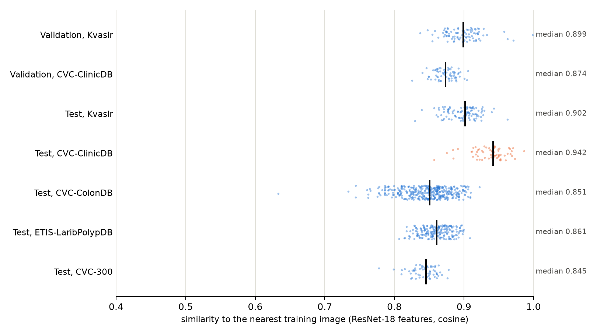

# Data inventory

Generated by `scripts/make_splits.py` (`make splits`). Do not edit by hand.

## Counts

| Set | Found | PraNet README |
|---|---|---|
| Train, Kvasir | 900 | 900 |
| Train, CVC-ClinicDB | 550 | 550 |
| Test, Kvasir | 100 | 100 |
| Test, CVC-ClinicDB | 62 | 62 |
| Test, CVC-ColonDB | 380 | 380 |
| Test, ETIS-LaribPolypDB | 196 | 196 |
| Test, CVC-300 | 60 | 60 |

## Exact duplicates between training and test images

None found (pixel-level hash).

## CVC-ClinicDB video sequences

The 612 frames come from 29 video sequences. The frame ranges are published with the dataset (Table 1 on https://polyp.grand-challenge.org/CVCClinicDB/), and are hard-coded in `seg.splits.CLINICDB_SEQUENCE_STARTS`.

- **Check against the images:** similarity of consecutive training frames separates the 28 sequence boundaries from within-sequence pairs with **AUC 0.965** (boundary median 0.750, within-sequence median 0.911). The table agrees with what the images show.
- **The PraNet CVC-ClinicDB test set shares videos with training:** its 62 test frames come from 26 sequences, and **26** of those also have training frames. Its test frames were sampled from the same videos as training frames, so it measures how well a model handles near-copies of what it trained on, not new patients.
- Sequences with no test frame at all: 11, 16, 29 (68 training frames).

## Validation split

Saved to `data/splits/val_seed0.json`.

| Source | Total | 10% target | In validation | Unit |
|---|---|---|---|---|
| CVC-ClinicDB | 550 | 55 | 68 | whole sequences 11, 16, 29 (no test frames) |
| Kvasir | 900 | 90 | 90 | image |

Training: 1292 images. Validation: 158 images.

## How close is each evaluation image to the training set

For every image, the cosine similarity of ResNet-18 features to its most similar training image (training = the split's training part). Higher means a near-copy of something seen in training.

| Set | Median | 90th percentile | Share above 0.95 |
|---|---|---|---|
| Validation, Kvasir | 0.899 | 0.921 | 4% |
| Validation, CVC-ClinicDB | 0.874 | 0.892 | 0% |
| Test, Kvasir | 0.902 | 0.925 | 1% |
| Test, CVC-ClinicDB | 0.942 | 0.966 | 26% |
| Test, CVC-ColonDB | 0.851 | 0.889 | 0% |
| Test, ETIS-LaribPolypDB | 0.861 | 0.888 | 0% |
| Test, CVC-300 | 0.845 | 0.861 | 0% |

Evaluation images above 0.98, i.e. practically copies of a training image:

- Validation, Kvasir: `cju886ryxnsl50801r93jai7q` (0.999)
